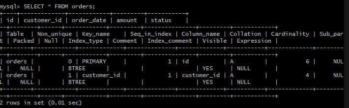
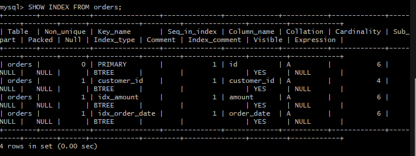
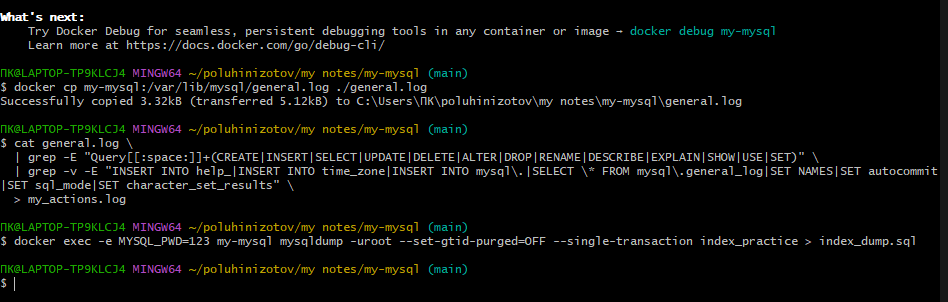

# Практическое руководство по индексам в MySQL

**Цель:** Научиться создавать индексы, читать план выполнения запроса (`EXPLAIN`) и понимать, когда индекс работает, а когда — нет.

---

## 1. Подготовка и запуск

Был создан конфигурационный файл `my.cnf` для включения общего лога (general log) и настройки кодировки UTF-8. Контейнер MySQL 8.0 успешно запущен с монтированием локальной папки и volume для сохранения данных.

Проверка логов внутри контейнера прошла успешно (файл `/var/lib/mysql/general.log` создается и пишется).

---

## 2. Создание структуры базы данных

Создана база `index_practice` с кодировкой `utf8mb4_unicode_ci`.
Созданы таблицы `customers` и `orders`. 
Таблица `orders` содержит внешний ключ на `customers`.

**Исходные данные в таблице `orders`:**
*(скриншот вывода `SELECT * FROM orders;`)*

> 

---

## 3. Анализ существующих индексов (Эксперимент 1)

Выполнена команда `SHOW INDEX FROM orders;`.
По умолчанию в таблице есть два индекса:
* `PRIMARY` (кластеризованный индекс по столбцу `id`).
* `customer_id` (некластеризованный индекс по внешнему ключу, создан автоматически).
Индекса по столбцу `amount` нет.

> 

---

## 4. EXPLAIN до создания индекса (Эксперимент 2)

Запрос: `EXPLAIN SELECT * FROM orders WHERE amount > 1000;`

**Результат:**
* `type`: **ALL** (Full scan — полный перебор строк).
* `key`: **NULL** (индекс не используется).
* `rows`: **6** (просматриваются все строки).

*Вывод:* MySQL вынужден читать всю таблицу, так как по столбцу `amount` нет индекса.

> 

---

## 5. Создание индекса и EXPLAIN после (Эксперимент 3)

Создан индекс: `CREATE INDEX idx_amount ON orders(amount);`
Запрос: `EXPLAIN SELECT * FROM orders WHERE amount > 1000;`

**Результат после индекса:**
* `type`: **range** (диапазонный поиск по индексу).
* `key`: **idx_amount** (индекс задействован).
* `rows`: **4** (просматривается меньше строк).

*Вывод:* Индекс работает. MySQL использует дерево B-tree для быстрого поиска нужного диапазона.

> 

---

## 6. Влияние функций в WHERE (Эксперимент 4)

Запрос: `EXPLAIN SELECT * FROM orders WHERE YEAR(order_date) = 2026;`
**Результат:** `type` = **ALL**, `key` = **NULL**. Индекс не используется.

*Причина:* Функция `YEAR()` применяется к каждой строке, из-за чего MySQL не может использовать индекс по `order_date`.

Создан индекс: `CREATE INDEX idx_order_date ON orders(order_date);`
Запрос переписан без функции: `EXPLAIN SELECT * FROM orders WHERE order_date >= '2026-01-01' AND order_date < '2027-01-01';`
**Результат:** `type` = **range**, `key` = **idx_order_date**.

*Вывод:* Функции над индексируемыми столбцами ломают индексы. Запросы нужно переписывать в виде диапазонов (`>=` и `<`).

> 

---

## 7. Составной индекс (Эксперимент 5)

Создан индекс: `CREATE INDEX idx_status_amount ON orders(status, amount);`

Проверены три запроса:
1. `WHERE status = 'paid'` — **type: ref**, key: `idx_status_amount`. (Индекс работает, `status` — первый столбец).
2. `WHERE status = 'paid' AND amount > 1000` — **type: range**, key: `idx_status_amount`. (Индекс работает).
3. `WHERE amount > 1000` — **type: ALL**, key: `idx_amount` (или NULL, если временно удалить `idx_amount`). Составной индекс `idx_status_amount` здесь **не используется**, так как `amount` не является первым (левым) столбцом индекса.

*Вывод:* Работает правило левого префикса. Индекс `(A, B)` работает для `A` и `(A, B)`, но не для `B`.

> 

---

## 8. Покрывающий индекс (Эксперимент 6)

Создан индекс: `CREATE INDEX idx_customer_amount ON orders(customer_id, amount);`
Запрос: `EXPLAIN SELECT customer_id, SUM(amount) FROM orders GROUP BY customer_id;`

**Результат:**
* `key`: **idx_customer_amount**
* `Extra`: **Using index**

*Вывод:* Это покрывающий индекс (Index-Only Scan). MySQL берет все нужные данные (customer_id и amount) прямо из дерева индекса, не обращаясь к самой таблице. Это самый быстрый вариант выполнения.

> **[МЕСТО ДЛЯ СКРИНШОТА: EXPLAIN SELECT customer_id, SUM(amount)... с Extra: Using index]**

---

## 9. EXPLAIN ANALYZE

Выполнен `EXPLAIN ANALYZE SELECT * FROM orders WHERE amount > 1000;`
*(Показывает реальное время выполнения шагов, а не预估 оценку оптимизатора).*

> 

---

## 10. Логирование действий и дамп базы

1. **Сбор лога:** Лог действий пользователя был выгружен из контейнера командой `docker cp`. С помощью утилиты `grep` в файле `general.log` были отфильтрованы системные вызовы (Connect, Quit, INSERT INTO help_ и т.д.). 
   Итоговый файл `my_actions.log` содержит только осмысленные SQL-команды, выполненные в ходе работы.

2. **Дамп базы:** Создан дамп базы данных `index_practice` (файл `index_dump.sql`). В дамп включены все созданные таблицы, данные и индексы. 

>

---

## Итоги работы

В ходе практики были подтверждены основные правила работы с индексами MySQL:
* **Индекс ускоряет чтение**, но замедляет запись (каждый `INSERT/UPDATE` обновляет B-tree).
* **Типы сканирования:** `ALL` — плохо (Full scan), `range` / `ref` — хорошо.
* **Функции в WHERE** (`YEAR()`, `LOWER()`) ломают индекс.
* **Составной индекс** работает по правилу левого префикса.
* **Покрывающий индекс** (Extra: `Using index`) избавляет от необходимости читать таблицу.