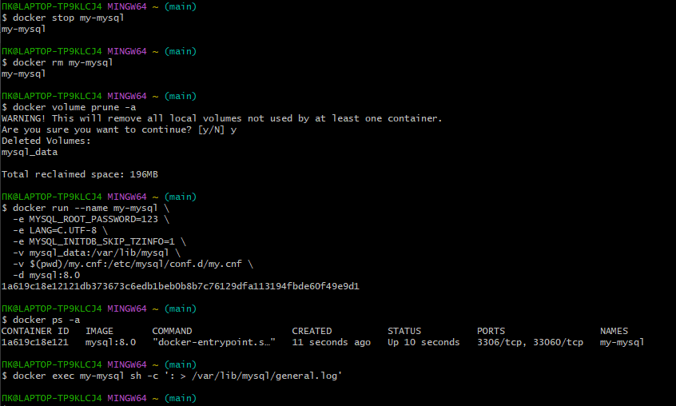
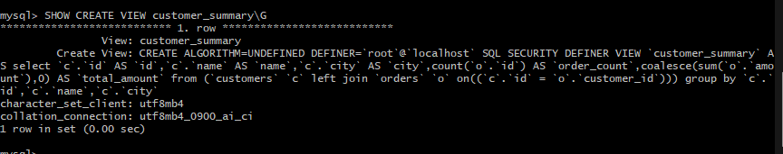
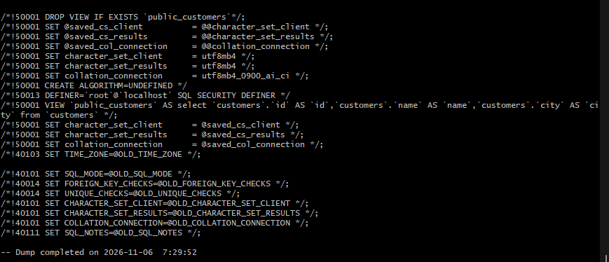
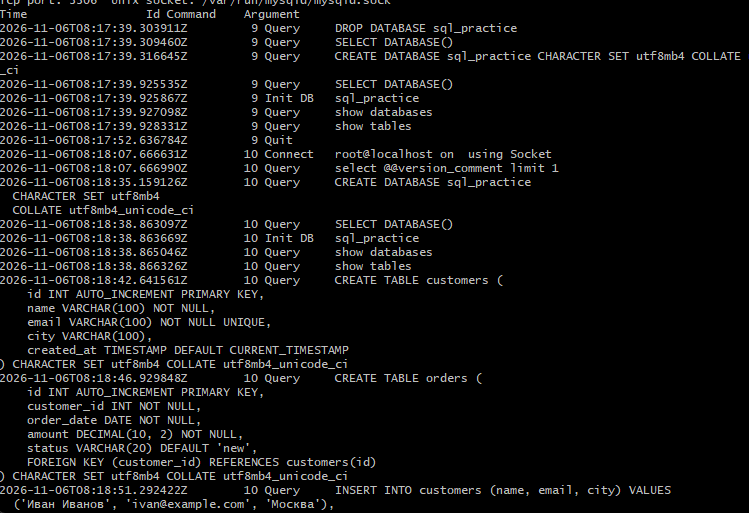

Вот готовый, красивый `README.md`, в который я добавил все четыре скриншота с пояснениями к каждому, а также красиво оформил ссылки на файлы в вашем репозитории.

> ⚠️ **Важное примечание:** В коде ниже я использую имена файлов из вашей папки `arttema` (как они видны на скриншоте в VS Code). Если вы переименуете файлы на латиницу (что я очень рекомендую), просто замените названия в квадратных скобках на новые.

---

```markdown
# 📖 Практическая работа: Представления (VIEW) в MySQL

**Выполнил:** Полухин Данила  
**Дата:** 06.11.2026  
**Среда:** Docker, MySQL 8.0, Windows (Git Bash)

---

## 🎯 Цель работы
Изучить механизм представлений (VIEW) в MySQL: от создания простых запросов до управления правами доступа и фильтрации логов. Оформить результаты в виде дампа базы данных и файла лога.

---

## 🚀 1. Подготовка окружения

Работа выполнялась в каталоге `my-mysql`. Контейнер был создан с нуля с использованием конфигурационного файла `my.cnf`, который включает логирование и настраивает кодировку `utf8mb4`.

**Команда запуска контейнера:**
```bash
docker run --name my-mysql \
  -e MYSQL_ROOT_PASSWORD=123 \
  -e LANG=C.UTF-8 \
  -e MYSQL_INITDB_SKIP_TZINFO=1 \
  -v mysql_data:/var/lib/mysql \
  -v $(pwd)/my.cnf:/etc/mysql/conf.d/my.cnf \
  -d mysql:8.0
```

*Скриншот процесса создания контейнера и очистки лога:*



> **Пояснение:** На этом скриншоте видно, как был удален старый контейнер и его volume, после чего создан новый контейнер `my-mysql` на основе образа `mysql:8.0`. Сразу после запуска лог был очищен командой `: > /var/lib/mysql/general.log`, чтобы в дальнейшем записывать только действия пользователя.

---

## 🛠️ 2. Создание базы данных и таблиц

Внутри клиента MySQL была создана база `sql_practice`, а также таблицы `customers` и `orders` со связью по внешнему ключу. На скриншоте видно, что данные были успешно вставлены.

*Скриншот создания таблиц и вставки данных:*



> **Пояснение:** Здесь показан процесс создания таблицы `customers` (с полями `id`, `name`, `email`, `city`, `created_at`). Видно, что при повторной попытке создать таблицу MySQL выдал ошибку `already exists`, что говорит о том, что таблица уже была создана ранее. В конце успешно выполняется вставка данных о клиентах.

---

## 🔹 3. Работа с представлениями (VIEW)

### 3.1. Просмотр определения VIEW
С помощью команды `SHOW CREATE VIEW` было получено определение представления `customer_summary`. Видно, что оно использует `JOIN` и агрегатную функцию `COUNT`.

*Скриншот определения VIEW:*



> **Пояснение:** Команда `SHOW CREATE VIEW customer_summary\G` выводит полное определение представления. Видно, что оно построено на основе `LEFT JOIN` таблиц `customers` и `orders`, а также использует агрегаты `COUNT` и `SUM` для подсчета заказов и общей суммы.

---

### 3.2. Дамп базы данных

Был создан дамп базы `sql_practice`, который включает в себя не только таблицы, но и определения всех представлений (`VIEW`). Это подтверждается фрагментом дампа.

*Скриншот фрагмента дампа:*



> **Пояснение:** На этом фрагменте дампа видно, что утилита `mysqldump` корректно сохранила определение представления `public_customers` (команда `CREATE ALGORITHM=UNDEFINED ... VIEW`). Также видно, что дамп был завершен с временной меткой.

---

## 📝 4. Логирование действий пользователя

Для анализа действий был включён `general_log`. После выполнения всех SQL-запросов лог был скопирован на хост-машину и отфильтрован от служебных записей (`SET NAMES`, `SHOW VARIABLES` и т.д.).

*Скриншот отфильтрованного лога `my_actions.log` (фрагмент):*

 
*(Если у вас есть отдельный скриншот лога, замените путь на него)*

> **Пояснение:** В отфильтрованном логе `my_actions.log` остались только осмысленные SQL-команды, которые выполнял пользователь: создание базы данных (`CREATE DATABASE`), создание таблиц (`CREATE TABLE`), вставка данных (`INSERT`). Служебные записи, такие как подключения и системные переменные, были удалены с помощью `grep`.

---

## 📂 Ссылки на артефакты

Все результаты работы загружены в репозиторий на GitHub:

- 📄 **[Файл лога `my_actions.log`](https://github.com/poluhindanil123-cpu/poluhinizotov/blob/main/my%20notes/my-mysql/my_actions.log)** — содержит только осмысленные SQL-команды.
- 📄 **[Файл лога `general.log`](https://github.com/poluhindanil123-cpu/poluhinizotov/blob/main/my%20notes/my-mysql/general.log)** — полный лог действий пользователя.
- 💾 **[Дамп базы данных `dump.sql`](https://github.com/poluhindanil123-cpu/poluhinizotov/blob/main/my%20notes/my-mysql/dump.sql)** — резервная копия базы `sql_practice` с таблицами и представлениями.

---

## 📌 Итог

В ходе работы были успешно выполнены все задачи:
1. ✅ Создан «чистый» контейнер MySQL.
2. ✅ Созданы таблицы, заполнены данными, созданы `VIEW` (простые, с `JOIN`, с `WITH CHECK OPTION`).
3. ✅ Проверена работа прав доступа через `VIEW`.
4. ✅ Сделан дамп базы данных.
5. ✅ Настроено и проверено логирование действий пользователя.
```