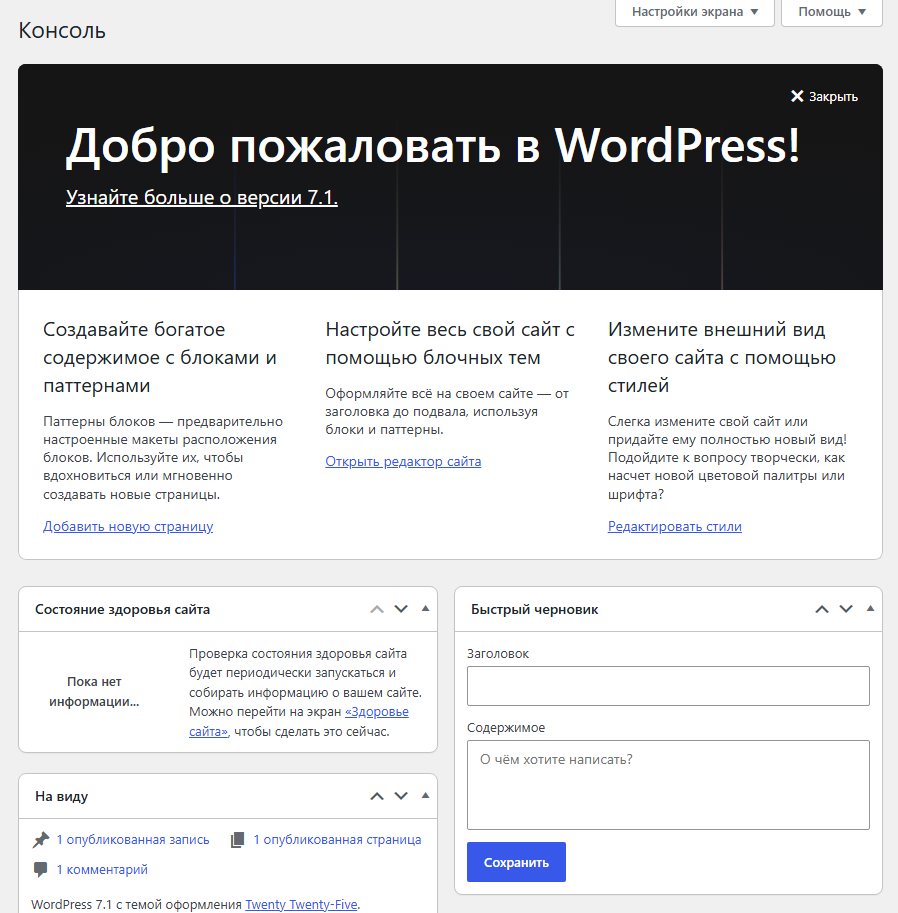
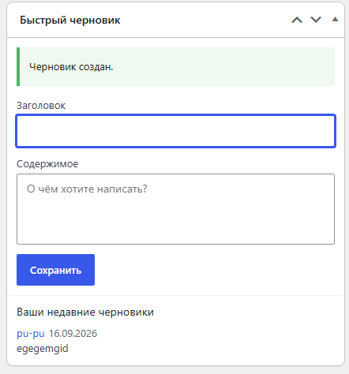
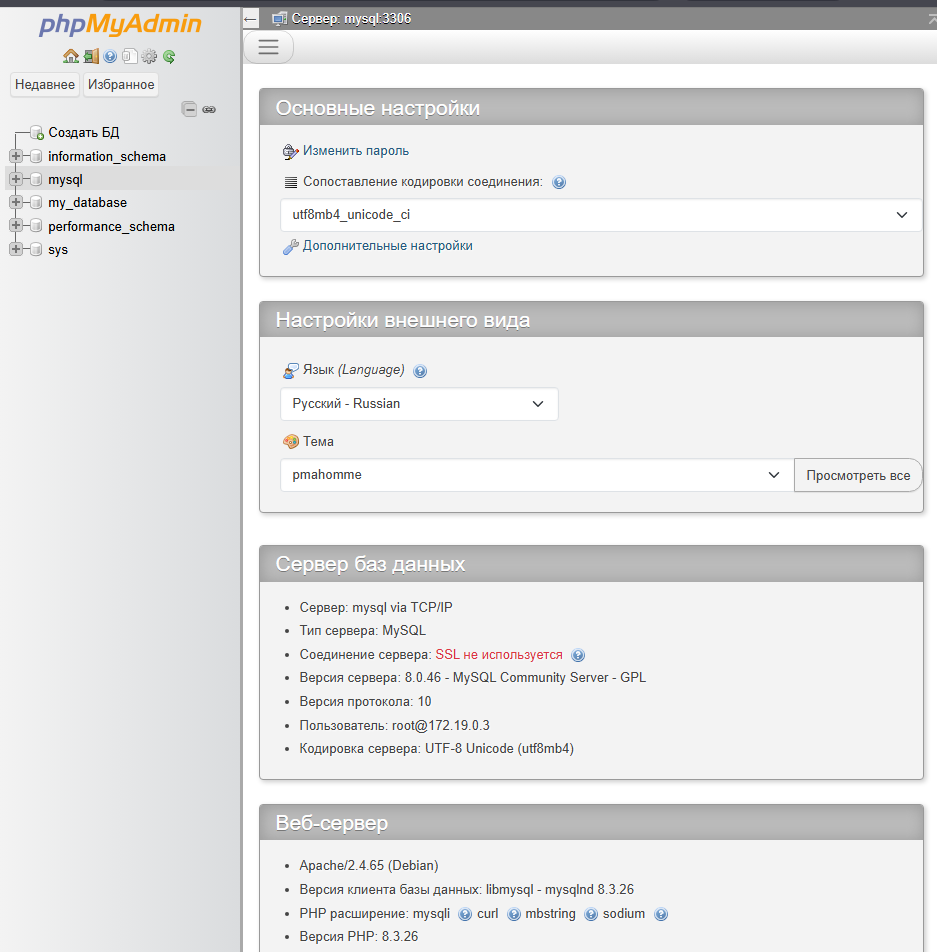
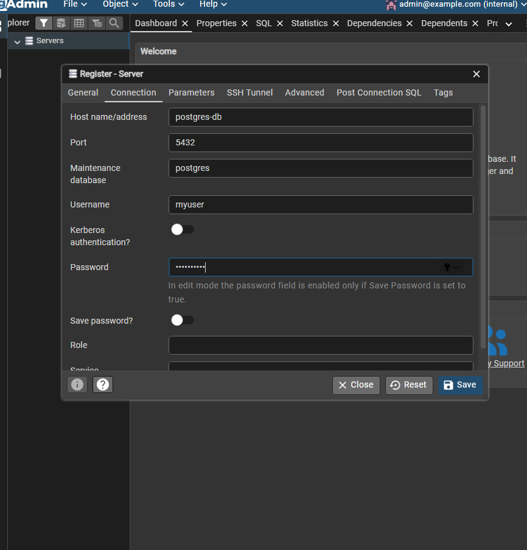
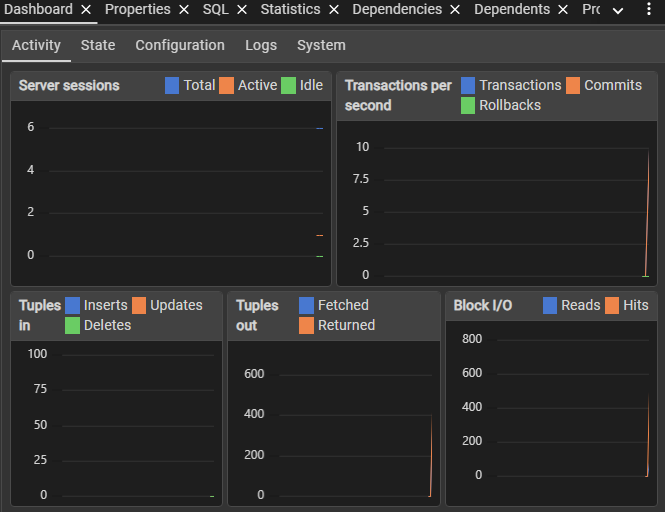

### Первый  проект на WordPress

Добро пожаловать в репозиторий моего проекта! Здесь я настраиваю и развиваю свой сайт на базе **WordPress 7.1** с использованием современной блочной темы **Twenty Twenty-Five**.

### показан быстрый черновик 
# там можно написать заголовок и описание

### phpMyAdmin

phpMyAdmin — веб‑приложение с открытым исходным кодом на PHP для администрирования MySQL/MariaDB через браузер. Предоставляет графический интерфейс для управления базами данных без необходимости писать SQL‑команды вручную.

### Docker compose конетейнеры с PostgresSQL

# PostgreSQL (часто — Postgres) — свободная объектно‑реляционная система управления базами данных (ORDBMS) с открытым исходным кодом.

### Docker compose конетейнеры c PostgreSQL+pgAdmin

 pgAdmin — официальный графический инструмент для администрирования PostgreSQL
PostgreSQL (часто — Postgres) — свободная объектно‑реляционная система управления базами данных (ORDBMS) с открытым исходным кодом.

### LibreDB Studio

LibreDB Studio — это открытая (MIT-лицензия) веб-IDE для работы с базами данных, которая разворачивается как контейнер Docker рядом с самой базой, а не на машине разработчика. По сути, это «браузерный DataGrip/DBeaver» — единая точка входа для запросов, визуализации и администрирования

### CloudBeaver

## CloudBeaver — это веб-версия популярного desktop-инструмента DBeaver